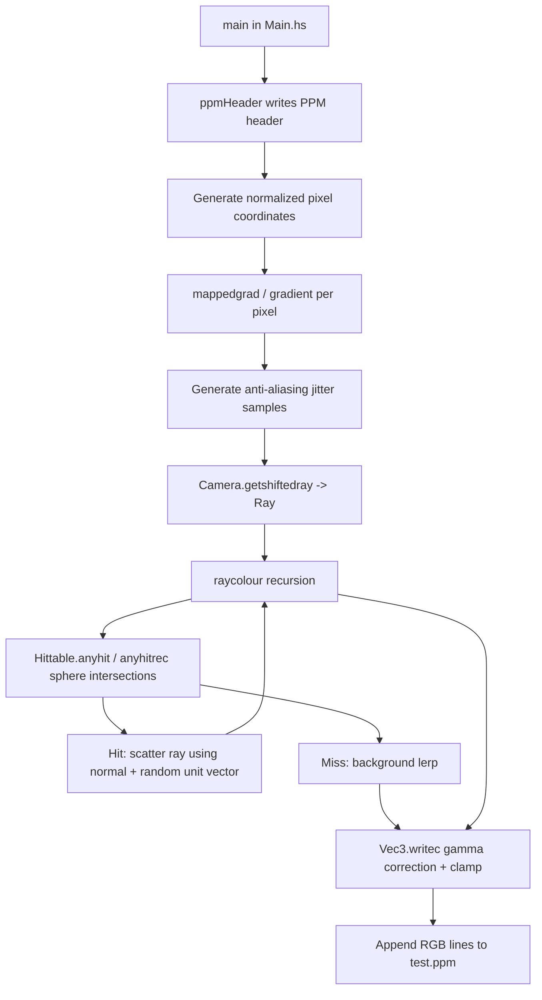

# CODE_EXPLANATION

## Table of contents
- [Repository overview](#repository-overview)
- [Module architecture](#module-architecture)
- [Rendering pipeline](#rendering-pipeline)
- [Mathematics implemented](#mathematics-implemented)
- [Haskell language features used](#haskell-language-features-used)
- [Execution trace (`main` to `test.ppm`)](#execution-trace-main-to-testppm)
- [Build and run](#build-and-run)
- [Limitations and potential bugs](#limitations-and-potential-bugs)

## Repository overview
This repository is a small, self-contained Haskell renderer based on *Ray Tracing in One Weekend*.

Code files:
- [Main.hs](./Main.hs): render loop, scene setup, recursive colour function.
- [Vec3.hs](./Vec3.hs): vector math, random vectors, colour write-out.
- [Ray.hs](./Ray.hs): ray type and parametric ray evaluation.
- [Hittable.hs](./Hittable.hs): sphere intersection and hit-record logic.
- [Camera.hs](./Camera.hs): camera geometry and ray generation.
- [ppm.hs](./ppm.hs): standalone PPM gradient writer example (separate executable-style script).
- [README.md](./README.md): short project description.

## Module architecture

### `Vec3`
Defines `type Vec3 = (Double, Double, Double)` and basic operations (`sumv`, `subv`, `dot`, `cross`, `mulscalar`, `divscalar`, `unitv`, `norm`), plus colour conversion (`writec`) and random vector helpers (`randomvec`, `randomuvec`).

### `Ray`
Defines:
```haskell
data Ray = Ray {origin :: Vec3, direction :: Vec3}
```
and `dirat ray t = origin + t * direction`.

### `Hittable`
Defines geometry and intersection results:
```haskell
data Hittable = Sphere { center :: Vec3, radius :: Double } | Empty
data HitRecord = HitRecord { p :: Vec3, normal :: Vec3, t :: Double }
```
`hitrecsphere` computes ray-sphere intersection roots and returns a `HitRecord`; `anyhitrec` traverses a list of objects and keeps the closest valid hit.

### `Camera`
Defines viewport/camera constants and maps normalized screen coordinates `(u, v)` to rays via `getray`/`getshiftedray`.

### `Main`
Owns render constants, world construction (`world = [mainsphere, bgdsphere]`), stochastic anti-aliasing offsets, recursive `raycolour`, pixel traversal, and writing `test.ppm`.

### `ppm.hs`
Independent script that writes a simple gradient image; it is not imported by other modules.

## Rendering pipeline



## Mathematics implemented

### Vectors
`Vec3` operations are direct tuple algebra in [Vec3.hs](./Vec3.hs):
- Dot product: `a·b = ax*bx + ay*by + az*bz`
- Cross product: standard 3D determinant formula.
- Unit vector: `v / ||v||`.

### Ray equation
[Ray.hs](./Ray.hs):
\[
\mathbf{r}(t) = \mathbf{o} + t\mathbf{d}
\]
implemented by `dirat`.

### Camera geometry
[Camera.hs](./Camera.hs) builds a pinhole camera:
- Aspect ratio `16/9`, viewport height `2`, focal length `1`.
- `lower_left_corner = origin - horizontal/2 - vertical/2 - (0,0,focal_len)`.
- Ray direction for `(u,v)`:
\[
\mathbf{d} = \text{lower\_left\_corner} + u\,\text{horizontal} + v\,\text{vertical} - \text{origin}
\]

### Ray-sphere intersection
[Hittable.hs](./Hittable.hs) solves the quadratic with half-\(b\) form:
- `oc = origin - center`
- `a = d·d`
- `bh = oc·d` (half of textbook `b`)
- `c = oc·oc - r^2`
- discriminant `bh^2 - a*c`
- roots `(-bh ± sqrt(discriminant)) / a`

Closest valid root in `[tmin, tmax]` is selected.

### Surface normals
At hit point `p`, outward normal is:
\[
\mathbf{n}_{out} = (\mathbf{p} - \mathbf{center}) / r
\]
`setfacenormal` flips it if the ray is inside (`dot(direction, outward) > 0`).

### Recursive colour
[Main.hs](./Main.hs), `raycolour`:
- Stop at depth 0 -> black.
- On hit -> scatter toward `p + n + random_unit_vector`, recurse, then attenuate by `1/2`.
- On miss -> sky gradient using normalized ray direction y-component:
\[
(1-t)\,(1,1,1) + t\,(0.5,0.7,1.0),\quad t=0.5(y+1)
\]

### Sampling and gamma
Per pixel, `samples_per_pixel = 20` rays are jittered (`randomarray`) and summed.
`writec` in [Vec3.hs](./Vec3.hs):
1. Divide by sample count.
2. Apply gamma-2 correction via `sqrt`.
3. Clamp to `[0, 0.999]`.
4. Scale to `[0,255]` integer output.

## Haskell language features used

- **Algebraic data types + records**: `Ray`, `Hittable`, `HitRecord` expose named fields (`origin`, `normal`, `t`).
- **Type aliases**: `type Vec3 = (Double, Double, Double)`, `type C3 = Vec3`.
- **Pattern matching**: pervasive in vector functions and intersection branches.
- **Guards**: branch logic in `raycolour`, `hitrecsphere`, `clamp`, etc.
- **Recursion**:
  - structural recursion over lists (`sumvectorarray`, `anyhitrec`),
  - depth recursion for path-tracing-like bounce limit (`raycolour`).
- **Higher-order/list programming**: `map`, list comprehensions for pixel grid, `sequenceA` to collect `IO [String]`.
- **`IO` workflow**:
  - random sampling via `newStdGen` and `randomRs`,
  - filesystem output via `writeFile`/`appendFile`,
  - render side effects orchestrated in `main`.

## Execution trace (`main` to `test.ppm`)
1. `main` writes PPM header (`ppmHeader "test.ppm"`).
2. It builds normalized pixel coordinate list `elements` by scanning rows top-to-bottom (`reverse colour_grady`) and columns left-to-right.
3. `mappedgrad` evaluates `gradient` for each pixel in `IO`.
4. `gradient`:
   - precomputes `max_depth` random unit vectors,
   - creates anti-alias offsets,
   - creates shifted rays through `getshiftedray`,
   - computes `raycolour` for each sampled ray,
   - sums samples and converts to one RGB string via `writec`.
5. `main` appends all RGB lines and prints `ppm file created!`.

## Build and run
No Cabal/Stack build configuration is present in this repository root (no `.cabal`, `package.yaml`, or `stack.yaml`).

Based on the file layout and imports, run directly with GHC tooling, for example:

```bash
runghc /home/runner/work/HaskellRayTracinginOneWeekend/HaskellRayTracinginOneWeekend/Main.hs
```

Output: `test.ppm` in the working directory.

`ppm.hs` can also be run independently:
```bash
runghc /home/runner/work/HaskellRayTracinginOneWeekend/HaskellRayTracinginOneWeekend/ppm.hs
```

## Limitations and potential bugs

### Confirmed from code
- **No project build metadata**: no Cabal/Stack config; reproducibility/dependency pinning is absent.
- **Anti-alias jitter is one-sided**: offsets are sampled in `[0, 1/width] × [0, 1/height]`, so jitter is not centered around the pixel.
- **Inconsistent `tmin` use**: `raycolour` hit test uses `tmin=0.001`, but `newhr = anyhitrec ... 0 ...`; this can select a different (nearer) intersection than the boolean hit test.
- **Potential divide-by-zero in normalization**: `unitv` has no zero-length guard; `randomuvec` can theoretically produce `(0,0,0)` from RNG.
- **Memory-heavy render path**: `main` stores all pixel strings in memory (`mgrad <- mappedgrad elements`) before writing.

### Deliberate simplifications (expected for this stage)
- Only spheres and a hardcoded scene (`world`) are supported.
- Material model is fixed diffuse-like scattering (`normal + random unit vector`) with constant attenuation.
- No acceleration structure (linear object traversal only).
- No camera transforms (camera fixed at origin looking toward `-z`).

### Assumptions (not directly proven)
- RNG quality/independence is assumed acceptable for this educational renderer.
- Performance scalability for larger scenes is likely limited due to pure list traversal and full in-memory output buffering.
